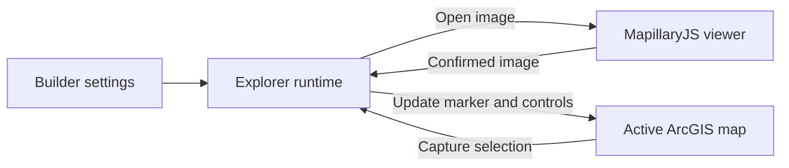

# Technical reference

Experience Builder loads the widget from its manifest. Settings save per-instance configuration into the experience. At runtime, the widget uses the active ArcGIS view for map interaction and MapillaryJS for imagery. Feature owners manage selection identity, request cancellation, and cleanup as the map, viewer, and settings change. [Architecture and ownership](development/architecture.md)

## How a capture opens

## Find a contract

| Surface | Where to look | What it controls |
| --- | --- | --- |
| Host metadata | [manifest.json](../manifest.json) | Widget ID, label, package and host versions, dependencies, default dimensions and map integration. |
| Instance defaults and types | [config.json](../config.json) · [Config interface](../src/config.ts) | Defaults and accepted keys. Some legacy keys remain to load older experiences. |
| Settings callbacks | [settings component](../src/setting/setting.tsx) | The host supplies setting props and receives updates through `onSettingChange`. |
| Runtime and map-view events | [runtime component](../src/runtime/widget.tsx) | The host provides widget props and the active map binding. See the architecture for feature-level ownership. |
| Optional external Places API | [service contract](development/places-service-contract.md) | Routes, query limits, response shape and deployment. |
| Notes and access | [Enterprise notes](administration/enterprise-notes.md) · [workspace operator kit](../tools/community-notes/README.md) | Hosting, schema, authentication and shared record permissions. |
| Maintainer commands | [Portable tests](development/portable-tests.md) · [Browser fixtures](development/browser-fixtures.md) · [bundle check](development/isolated-build-check.md) | Dependency preflights, test suites and isolated compile checks. |

The Experience Builder host APIs and documented external service contract are integration surfaces. Explorer feature modules, state, test runners and callbacks are maintained with this repository and may change between versions. There is no separate Explorer plugin SDK or package to import.

The current runtime reads the Mapillary token from manifest properties. The legacy token field in saved configuration does not override it. Treat browser configuration as visible to viewers and keep privileged secrets in the relevant backend. [Runtime configuration](../src/config.ts)
